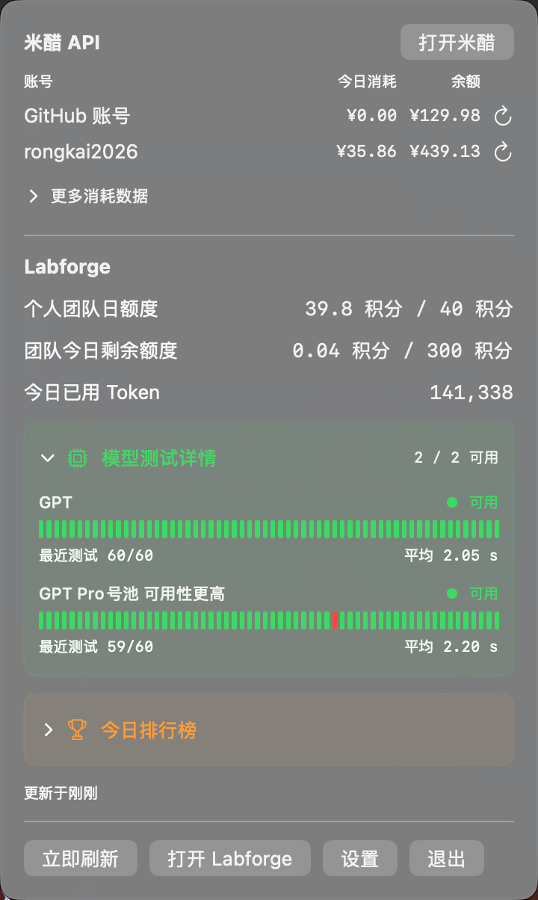

# TokenBoard

给自己用的 macOS 菜单栏额度看板。点击菜单栏的闪电图标，就能查看 Labforge 还剩多少额度、哪些模型可用，以及多个米醋 API 账号今天花了多少、还剩多少余额。



这张图就是实际打开菜单后的样子：顶部是多个米醋账号的今日消耗和余额，中间是 Labforge 额度与今日 Token 用量，下方是模型可用性测试和今日排行榜。底部可以立即刷新、打开 Labforge、进入设置或退出应用。

## 日常怎么看

| 我想知道什么             | 在哪里看                                           |
| ------------------ | ---------------------------------------------- |
| 米醋各账号今天花了多少、还剩多少钱？ | 顶部“米醋 API”表格，同时显示各账号的今日消耗和余额                   |
| 米醋最近 24 小时和累计花了多少？ | 展开“更多消耗数据”，也能看到各账号更新时间                         |
| Labforge 今天还能用多少？  | “个人团队日额度”和“团队今日剩余额度”，按剩余 / 总额度显示；下方是今日已用 Token |
| Labforge 哪些模型目前可用？ | “模型测试详情”，显示可用模型数量，展开查看分组详情                     |
| Labforge 今日用量排名如何？ | 展开“今日排行榜”                                      |
| 数据旧了，怎么更新？         | 每 5 分钟自动刷新；也可点击底部“立即刷新”，或单独刷新一个米醋账号            |

首次使用在“设置”中登录 Labforge、添加米醋账号。模型测试详情是否默认展开可在设置中调整；更多消耗数据和今日排行榜默认折叠。刷新失败时保留上次成功数据并提示错误。

不再包含 Codex Key 池或 API Key 切换、同步功能。

## 米醋 API

支持多个米醋账号，菜单以紧凑表格同时展示各账号余额和今日消耗；展开“更多消耗数据”可看近 24 小时、累计消耗与更新时间。每个账号可独立刷新、修改备注或从应用移除；移除不会删除平台账号。原有单账号登录会自动迁移，重启后恢复账号列表。迁移只在首次执行，移除全部账号后不会重新导入旧登录。

模型测试详情可折叠，默认展开；设置中的“默认展开模型测试详情”会保存偏好，并在每次打开菜单时应用。菜单中临时展开或收起不修改默认设置。更多消耗数据和今日排行榜默认折叠。

在“设置”中填写可选账号备注，点击“通过 GitHub 授权登录米醋”，在独立网页登录窗口中选择 GitHub 并完成授权，返回米醋后点击窗口下方的“完成登录”。应用验证米醋会话后，将米醋会话 Cookie 和用户 ID 存入 macOS 钥匙串，供重启恢复。应用不会导入 GitHub Cookie 或读取 GitHub 密码；GitHub 登录页的浏览器数据由 WebKit 管理。会话过期后需重新授权。

也可输入米醋用户名和密码，点击“添加账号密码账号”。验证成功才保存，失败不会覆盖已有账号；再次添加同一用户名或同一 GitHub 用户 ID 会更新对应登录。账号密码同样保存在钥匙串。各账号使用独立网络会话，应用每 5 分钟自动刷新，也可点击各账号的刷新按钮或“立即刷新”。一个账号失败不影响其他账号或 Labforge。

- 余额、累计消耗来自米醋账户接口，货币单位按平台配置换算。
- 近 24 小时消耗采用米醋概览相同的小时聚合接口，可能有约 5 分钟延迟。
- 今日消耗从北京时间（Asia/Shanghai）零点至请求时刻，使用消耗日志统计接口。
- 刷新失败保留上次成功数据并明确提示；未登录时不显示虚假的零余额。
- GitHub 授权、验证码和二步验证由用户在登录网页中完成；密码直接登录不支持额外验证。

## 构建与验证

首次克隆后，先复制不含凭证的模板（应用内可在设置中登录）。本地默认账号文件不纳入 Git：

```bash
cp Sources/LabforgeCore/DefaultLabforgeCredentials.swift.example Sources/LabforgeCore/DefaultLabforgeCredentials.swift
```

```bash
swift build
swift run LabforgeVerify
swift run MicuVerify
swift run MicuOAuthVerify
./scripts/build_dmg.sh
```

发布产物：`dist/TokenBoard.dmg`，内含 `TokenBoard.app`。旧 Key 池的本地数据和旧版本安装包不会自动删除；应用不会再读取或应用其中的 Key。
